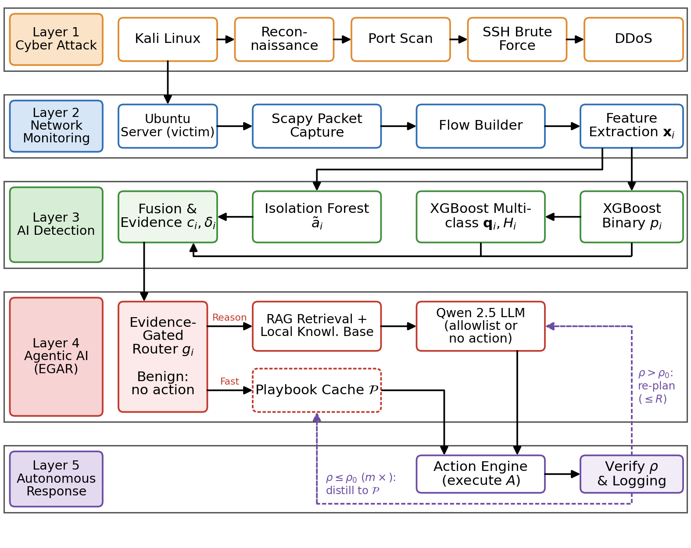

# Cyber Agent: Evidence-Gated Agentic AI for Autonomous Cyber Defense

Official implementation of **"Cyber Agent: An Agentic AI Framework for Autonomous Cyber Defense Using Hybrid Machine Learning, Retrieval-Augmented Generation, and Large Language Models."**

Cyber Agent connects live traffic capture, hybrid detection (XGBoost + Isolation Forest), retrieval-augmented generation (RAG), a locally deployed Qwen 2.5 (3B) large language model (LLM), and automated response in one agentic pipeline. Its decisions are controlled by **EGAR (Evidence-Gated Adaptive Reasoning and Response)**, which

- **gates** LLM use by the detection evidence (detector confidence, category uncertainty, inter-detector disagreement),
- **verifies** every mitigation with a residual-attack ratio and **re-plans** if the attack persists, and
- **distills** verified decisions into a reusable playbook, so repeated attacks skip the LLM.



## Repository structure

```
cyber-agent/
├── cyber_agent/
│   ├── features.py        # packets -> bidirectional flows -> feature vector x_i (Eq. 1)
│   ├── detection.py       # binary/multiclass XGBoost + Isolation Forest, fusion (Eq. 4), evidence label (Eq. 5)
│   ├── knowledge_base.py  # local knowledge base B and TF-IDF retrieval for RAG
│   ├── llm_ollama.py      # Qwen 2.5 (3B) via Ollama, constrained to the action allowlist
│   ├── action_engine.py   # iptables actions on the victim (dry-run by default)
│   ├── observer.py        # residual attack ratio rho after an action (Eq. 7)
│   ├── egar.py            # EGAR (Algorithm 1)
│   ├── baselines.py       # static playbook, LLM-always, memory agent, confidence-only gating
│   └── factory.py         # builds any agent from the config and trained models
├── scripts/
│   ├── capture.py         # capture labeled flows per scenario (live or pcap)
│   ├── train_detectors.py # train detectors, report detection and unseen-attack results
│   ├── run_agent.py       # run EGAR or a baseline live on the cyber range
│   └── evaluate.py        # compute Table I (phi, latency, mitigation, FAR, DDoS) from logs
├── configs/egar.yaml      # thresholds and settings
├── data/kb/attacks.json   # knowledge-base entries
├── tests/                 # unit and offline end-to-end tests (synthetic traffic)
└── docs/                  # figures
```

## Requirements

- Python 3.12, root access on the victim for capture and iptables
- Oracle VirtualBox 7.x cyber range: Kali Linux (attacker) and Ubuntu Server (victim)
- [Ollama](https://ollama.com) with the Qwen 2.5 3B model

```bash
git clone https://github.com/<your-username>/Cyber-Agent.git
cd Cyber-Agent
pip install -r requirements.txt
ollama pull qwen2.5:3b
pytest -q tests          # offline tests, no cyber range needed
```

## Reproducing the experiments

All commands run on the Ubuntu Server victim; replace the interface and IP addresses with yours.

**1. Capture labeled flows** (one run per scenario, attacks launched from Kali):

```bash
sudo python scripts/capture.py --iface enp0s3 --label benign --duration 600 --out data/flows/benign.csv
sudo python scripts/capture.py --iface enp0s3 --label recon --attacker 192.168.56.101 --out data/flows/recon.csv
sudo python scripts/capture.py --iface enp0s3 --label port_scan --attacker 192.168.56.101 --out data/flows/port_scan.csv
sudo python scripts/capture.py --iface enp0s3 --label ssh_bruteforce --attacker 192.168.56.101 --out data/flows/ssh.csv
sudo python scripts/capture.py --iface enp0s3 --label ddos --attacker 192.168.56.101 --out data/flows/ddos.csv
```

Example attacks from Kali: `nmap -sn 192.168.56.0/24` (recon), `nmap -sS -p- 192.168.56.102` (port scan),
`hydra -l root -P wordlist.txt ssh://192.168.56.102` (SSH brute force), `hping3 -S --flood -p 80 192.168.56.102` (DDoS).

**2. Train the detectors** with DDoS held out (unseen-attack protocol):

```bash
python scripts/train_detectors.py --data "data/flows/*.csv" --holdout ddos --out models/
```

**3. Run each agent live** while the attack scenarios run (repeat for every scenario):

```bash
for AGENT in static llm_always memory confidence egar_r1 egar; do
  sudo python scripts/run_agent.py --agent $AGENT --scenario ssh_bruteforce --iface enp0s3 \
       --victim 192.168.56.102 --attackers 192.168.56.101 --duration 300 \
       --log logs/${AGENT}_ssh.jsonl --execute
  sudo iptables -F INPUT; sudo iptables -F OUTPUT     # reset between runs
done
```

**4. Build Table I:**

```bash
python scripts/evaluate.py "logs/*.jsonl" --latex
```

## Using EGAR in your own code

```python
from cyber_agent.detection import HybridDetector
from cyber_agent.knowledge_base import KnowledgeBase
from cyber_agent.llm_ollama import make_llm
from cyber_agent.action_engine import make_executor
from cyber_agent.observer import LiveObserver
from cyber_agent.factory import build_agent, load_config

conf = load_config("configs/egar.yaml")
det = HybridDetector.load("models")
agent = build_agent("egar", conf, det, KnowledgeBase("data/kb"),
                    make_llm(conf["allowlist"]), make_executor(dry_run=True),
                    LiveObserver("enp0s3", det))
result = agent.process(flow_features, source_ip)   # path, action, outcome, rounds, rho, latency
```

## Attack scenarios

Reconnaissance, port scanning, Secure Shell (SSH) brute-force, and distributed denial-of-service (DDoS). For the unseen-attack experiment, DDoS is excluded from supervised training and introduced only at test time.

## Citation

If you use this code, please cite:

```bibtex
@inproceedings{cyberagent2027,
  title     = {Cyber Agent: An Agentic {AI} Framework for Autonomous Cyber Defense Using Hybrid Machine Learning, Retrieval-Augmented Generation, and Large Language Models},
  author    = {Author 1 and Author 2 and Author 3},
  booktitle = {Proc. IEEE PerCom Workshops},
  year      = {2027}
}
```

## License

Released under the MIT License (see `LICENSE`).
